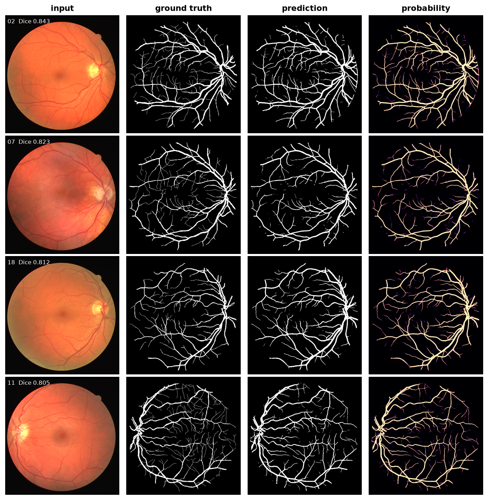
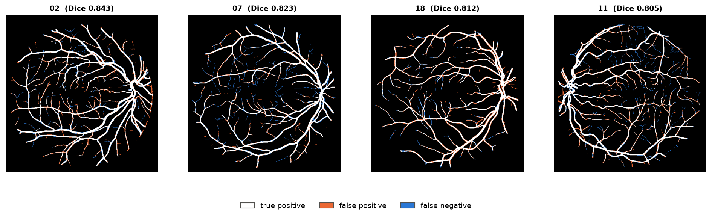
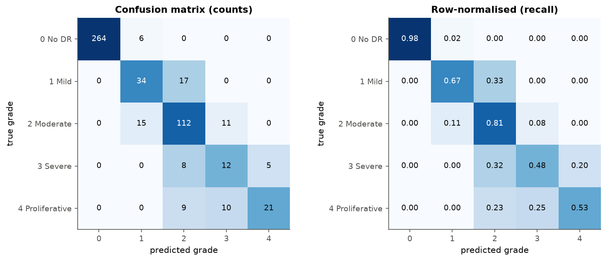
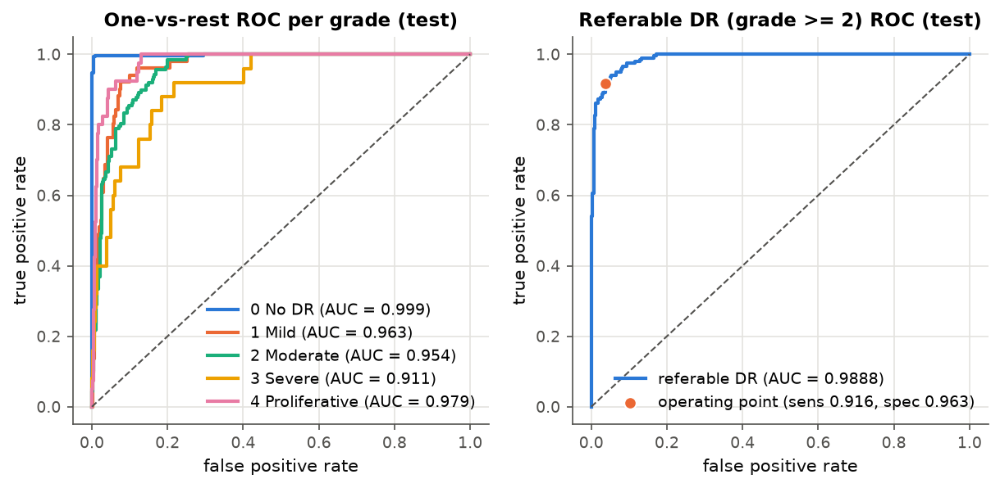
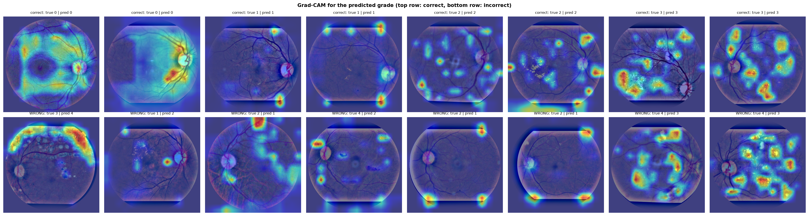

# retina-cv: retinal vessel segmentation and diabetic retinopathy grading

Two deep-learning pipelines on colour fundus photographs, written in PyTorch:

- **Part A, vessel segmentation** on DRIVE and FIVES: U-Net, Attention U-Net and a U-Net with an ImageNet-pretrained ResNet34 encoder, trained on random patches and applied to whole images with overlapping sliding windows.
- **Part B, diabetic retinopathy (DR) grading** on APTOS 2019: EfficientNet-B0, ResNet50 and ConvNeXt-Tiny, with classification and regression heads, calibration analysis and Grad-CAM.
- **Part C, efficiency**: parameter counts, FLOPs, ONNX export with a numerical check, and latency / throughput for PyTorch vs. ONNX Runtime on CPU and GPU.

Every number in this repository is produced by the code in it. The tables in [RESULTS.md](RESULTS.md) and the summary below are generated from the `metrics.json` files by `scripts/make_results.py`; nothing is typed in by hand.

## Headline results

The model shown for each task is the one with the best **validation** score; the test set is only used to report it. Values are mean ± standard deviation over seeds.

<!-- RESULTS:START -->
| Task | Selected model (by validation) | Seeds | Test result |
|---|---|---|---|
| Vessel segmentation, DRIVE (20 test images) | `drive_attunet_green` | 5 | Dice 0.8218 ± 0.0010, IoU 0.6975 ± 0.0014, sensitivity 0.8464 ± 0.0041, specificity 0.9689 ± 0.0012, AUC-ROC 0.9784 ± 0.0005, AUC-PR 0.9083 ± 0.0007 |
| Vessel segmentation, FIVES (200 test images) | `fives_r34unet_rgb_native` | 1 | Dice 0.9265, IoU 0.8631, sensitivity 0.9171, specificity 0.9935, AUC-ROC 0.9947, AUC-PR 0.9732 |
| DR grading, APTOS 2019 (524 test images) | `convnext_tiny_plain_reg` | 3 | QWK 0.9337 ± 0.0040, accuracy 0.8181 ± 0.0106, macro F1 0.6765 ± 0.0120; referable DR: AUC 0.9873 ± 0.0019, sensitivity 0.9360 ± 0.0106, specificity 0.9470 ± 0.0127 |
| Same, best 5-class softmax model | `convnext_tiny_ben` | 3 | QWK 0.9311 ± 0.0023, accuracy 0.8550 ± 0.0071, macro F1 0.7114 ± 0.0124, referable AUC 0.9879 ± 0.0023, ECE 0.0737 ± 0.0240 → 0.0409 ± 0.0122 after temperature scaling |
<!-- RESULTS:END -->

Full comparison tables, the efficiency table and a discussion of what worked are in [RESULTS.md](RESULTS.md).

| DRIVE: input, manual annotation, prediction, probability | DRIVE: error map (white TP, orange FP, blue FN) |
|---|---|
|  |  |

| APTOS: confusion matrix | APTOS: ROC curves |
|---|---|
|  |  |



## Data

| Dataset | Used for | Images | Split used here |
|---|---|---|---|
| [DRIVE](https://drive.grand-challenge.org/) | vessel segmentation | 40 (584×565), manual vessel masks + FOV masks | official 20 train / 20 test; 4 of the 20 training images held out for validation |
| [FIVES](https://doi.org/10.1038/s41597-022-01564-3) | vessel segmentation | 800 (2048×2048), manual vessel masks | official 600 train / 200 test; 60 training images held out for validation |
| [APTOS 2019](https://www.kaggle.com/competitions/aptos2019-blindness-detection) | DR grading (0–4) | 3,662 labelled | stratified 70 / 15 / 15 after duplicate removal: 2,442 / 523 / 524 |

Things worth knowing about the data:

- **Model selection never touches a test set.** Best checkpoint, early stopping, segmentation threshold, temperature and regression cut points are all chosen on validation images.
- **APTOS duplicates.** 266 of the 3,662 images are the same photograph stored under more than one id (129 groups). One copy per group is kept; the 77 images whose copies carry different grades are dropped. This leaves 3,489 images and prevents the same photo from landing in both train and test.
- **APTOS has no patient ids.** Two different photos of the same patient (or the same eye) can still be on both sides of the split, so patient-level leakage cannot be fully ruled out. The reported numbers are image-level.
- **APTOS acquisition bias.** Images come from several cameras with different crops, and the Grad-CAM maps show the model sometimes attending to the image border. Part of the test performance may come from such shortcuts and would not transfer to another clinic.
- **FIVES has no FOV masks**; the field of view is derived by thresholding near-black pixels.
- The split files are committed in [`data/splits/`](data/splits/), and the verified dataset summaries are in `results/data_summary_*.json`.

## Method in brief

**Segmentation.** CLAHE-enhanced green channel (1 channel) or CLAHE on the lightness channel with colour kept (3 channels); per-image z-scoring inside the FOV. Training on random 64×64 patches (DRIVE), 256×256 patches of the 1024×1024 downsized image (FIVES) or 512×512 patches at the native 2048×2048 (FIVES, one ablation run per model) with flips, 90° rotations and intensity jitter. Loss: Dice + BCE (or Dice + focal), computed inside the FOV. Inference: sliding windows with 50% overlap, probabilities averaged. Metrics are pooled over all FOV pixels of the test set at native resolution; ROC / PR curves are built from 4,096-bin probability histograms so they scale to the 800 million test pixels of FIVES. Vessel density (vessel pixels / FOV pixels) is compared between prediction and manual annotation per image.

**Grading.** Black borders cropped, image padded to a square and resized to 512×512, optionally followed by Ben Graham local-colour normalisation. Augmentation: random resized crop, flips, rotation, mild brightness / contrast; no hue or saturation changes. Class imbalance is handled with an **inverse-frequency class-weighted loss** (cross-entropy for the 5-class head; per-sample weighted smooth-L1 for the regression head). The regression head predicts one continuous grade, cut into grades with four thresholds optimised for QWK on validation. Reported: quadratic weighted kappa (primary), accuracy, macro F1, per-class report, referable DR (grade ≥ 2) AUC / sensitivity / specificity, and expected calibration error before and after temperature scaling.

**Shared.** AdamW with a one-cycle schedule, mixed precision, best-validation checkpointing, early stopping, fixed seeds. Each run stores its config, environment and git commit in its results folder.

## Setup

```bash
conda create -n retina python=3.12 && conda activate retina
pip install torch==2.5.1 torchvision==0.20.1 --index-url https://download.pytorch.org/whl/cu121
pip install -r requirements.txt
```

Developed on Linux with Python 3.12, PyTorch 2.5.1 (CUDA 12.1) and RTX A5000 / A4000 GPUs. The largest run needs about 9 GB of GPU memory, so everything also fits on a 16 GB Colab / Kaggle T4.

## Data download

Put Kaggle API credentials in `~/.kaggle/` and accept the [APTOS competition rules](https://www.kaggle.com/competitions/aptos2019-blindness-detection/rules) on the website, then:

```bash
scripts/download_data.sh              # DRIVE, FIVES, APTOS 2019 into data/raw/  (about 10 GB)
python -m src.data.prepare --dataset all   # verify, cache, write splits and data summaries
```

## Reproducing the results

Every script takes a config; `--seed` overrides the seed and `--smoke` runs one tiny epoch as a pipeline check.

```bash
# one experiment (train + test evaluation, all figures and metrics.json)
scripts/run.sh seg configs/seg/drive_attunet_green.yaml 0 1 2 3 4
scripts/run.sh cls configs/cls/convnext_tiny_plain.yaml 0 1 2

# everything
scripts/run_drive_all.sh                                   # 6 DRIVE configs x 5 seeds
for c in fives_unet_green fives_attunet_green fives_r34unet_rgb; do scripts/run.sh seg configs/seg/$c.yaml 0 1 2; done
scripts/run.sh seg configs/seg/fives_r34unet_rgb_native.yaml 0   # native 2048 px, about 1 h and 40 GB RAM
scripts/run_cls_queue.sh effnet_b0_plain effnet_b0_ben effnet_b0_plain_reg resnet50_plain \
                         convnext_tiny_plain convnext_tiny_ben convnext_tiny_plain_reg

# Grad-CAM, ONNX export + check, benchmark
python -m src.explain     --config configs/cls/convnext_tiny_ben.yaml
python -m src.export_onnx --task cls --config configs/cls/convnext_tiny_plain_reg.yaml
python -m src.benchmark   --task cls --config configs/cls/convnext_tiny_plain_reg.yaml

python scripts/make_results.py        # rebuild RESULTS.md and the table above
```

Approximate training time per run on one RTX A5000: DRIVE 1.5 min, FIVES at 1024 px 12–30 min, FIVES at native resolution 55–75 min, APTOS 10–25 min.

## Tests

The test suite needs no datasets or GPU; it uses small synthetic images and also runs both training scripts end to end in `--smoke` mode. CI runs it, plus `ruff`, on every push and pull request.

```bash
pip install pytest ruff
pytest              # under a minute on CPU
ruff check src scripts tests
```

## Repository layout

```
configs/seg, configs/cls   one YAML per experiment
src/data/                  prepare.py (verification, caching, splits), seg_data.py, cls_data.py
src/models/                unet.py (U-Net, Attention U-Net, ResNet34 U-Net factory), classifier.py
src/train_seg.py, eval_seg.py, train_cls.py, eval_cls.py
src/explain.py             Grad-CAM
src/export_onnx.py, benchmark.py
src/utils/                 metrics.py, plots.py, common.py (seeding, config, logging)
tests/                     pytest suite (synthetic data, CPU only)
scripts/                   download, run queues, make_results.py
results/                   per-run metrics.json, figures, config, environment
data/splits/               committed split files
```

Each `results/<task>/<run>/` folder contains `metrics.json`, `metrics.txt`, `history.json`, `config.yaml`, `env.json`, the training log and the figures (training curves, ROC / PR, Dice vs. threshold, qualitative grid, error maps, per-image Dice, vessel density; or confusion matrix, ROC curves, reliability diagram, class distribution, Grad-CAM, most confident errors).

## Limitations

- Research code on public benchmarks; not validated for clinical use.
- The native-resolution FIVES runs are single-seed; all other experiments use 3 or 5 seeds.
- CPU latency was measured on a shared machine under load (see RESULTS.md); GPU latency on an idle GPU.
- DRIVE has 20 test images and 4 validation images, so differences of a few thousandths in Dice between models are within seed noise.
- The eight earliest runs were started before the first git commit, so their `env.json` records the commit as `unknown`; later runs record the hash.
